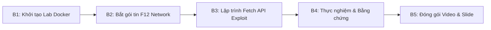
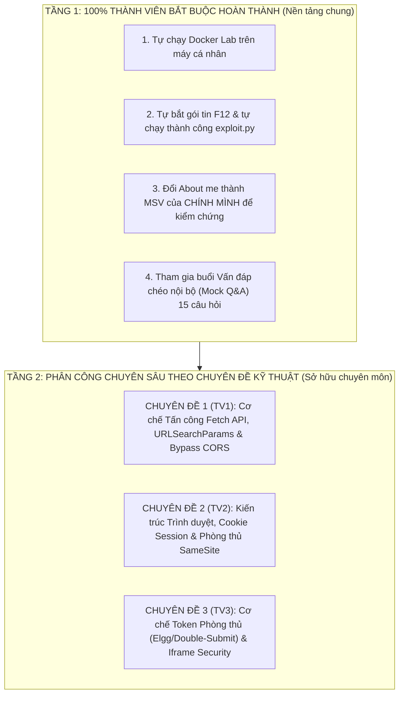

# 01. KẾ HOẠCH DỰ ÁN, PHƯƠNG PHÁP THỰC HIỆN VÀ PHÂN CÔNG NHIỆM VỤ

---

## 🎯 1. Thông tin đề tài chi tiết

### 1.1. Bối cảnh và Mục tiêu đề tài
- **Tên đề tài:** Khai thác lỗ hổng Cross-Site Request Forgery (CSRF) trên nền tảng Elgg Social Network bằng Fetch API hiện đại.
- **Hệ thống mục tiêu:** Ứng dụng mã nguồn mở Elgg (chạy trên môi trường container SEED Labs: Apache Web Server tại `www.seed-server.com`, MySQL Database).
- **Mục tiêu tấn công:** Giả mạo một HTTP POST Request xuất phát từ máy chủ của Attacker (`www.attacker32.com`) gửi đến máy chủ Elgg để thay đổi nội dung trường **About me** (trong mã nguồn Elgg tương ứng với trường `description`) của nạn nhân (ví dụ tài khoản `Alice`) thành chuỗi ký tự:
  $$\text{“CSRF attack by <MSV>”}$$
  *(Trong đó `<MSV>` là Mã số sinh viên của một thành viên trong nhóm).*
- **Ràng buộc kỹ thuật cốt lõi (Cực kỳ quan trọng):**
  1. **KHÔNG** sử dụng `XMLHttpRequest` (XHR) như hướng dẫn mẫu của SEED Lab cũ.
  2. **KHÔNG** sử dụng thẻ `<form>` HTML với cơ chế tự động submit (`form.submit()`) vì phương pháp này gây chuyển hướng trang (page redirect), để lộ dấu vết tấn công.
  3. **BẮT BUỘC** sử dụng **Fetch API (`fetch()`)** kết hợp với đối tượng **`URLSearchParams`** hoặc **`FormData`** để đóng gói dữ liệu request dạng ngầm (`asynchronous`).

### 1.2. Các sản phẩm bàn giao (Deliverables)
1. **Mã nguồn khai thác:**
   - File `index.html` (đặt tại web server của Attacker `www.attacker32.com`).
   - File chương trình `exploit.py` (theo yêu cầu tại `README.md`).
2. **Slide thuyết trình (PowerPoint):**
   - Thiết kế cho thời lượng trình bày **10 phút**.
   - Chứa sơ đồ luồng dữ liệu, phân công nhiệm vụ, các bước thực hiện và ảnh chụp màn hình bằng chứng.
3. **Video Demo thực hành:**
   - Độ dài khoảng 5 – 8 phút, ghi lại toàn bộ thao tác màn hình có thuyết minh/lồng tiếng.
   - Upload lên **YouTube ở chế độ Không công khai (Unlisted)**.
4. **Báo cáo chuyên môn & Trả lời câu hỏi:**
   - Trả lời đầy đủ, chi tiết 15 câu hỏi trong file `9. CSRF.docx`.
   - Bảng phân loại mức độ áp dụng AI minh bạch theo quy định của giảng viên.

---

## 🔬 2. Phương pháp thực hiện (Methodology)

Quy trình nghiên cứu và triển khai được xây dựng theo 5 bước khoa học:

### Bước 1: Thiết lập và Kiểm thử môi trường SEED Labs
- Chạy hệ thống Docker Compose từ thư mục Labsetup của SEED Labs (`seed-server.com`, `attacker32.com`, `mysql`).
- Kiểm tra kết nối mạng nội bộ và cấu hình `/etc/hosts` để ánh xạ đúng tên miền ảo.
- Xác nhận các tài khoản thử nghiệm trên Elgg: `alice / seedalice`, `boby / seedboby`, `samy / seedsamy`.

### Bước 2: Phân tích HTTP Traffic bằng DevTools
- Đăng nhập tài khoản Alice trên `www.seed-server.com`.
- Truy cập chức năng **Edit Profile** (`/profile/alice/edit`).
- Mở DevTools (F12) $\rightarrow$ Tab **Network**, tích chọn **Preserve log**.
- Bấm **Save** để bắt trọn vẹn HTTP POST Request gửi tới URL endpoint: `http://www.seed-server.com/action/profile/edit`.
- Trích xuất toàn bộ các tham số:
  - `guid`: User ID của Alice (thường là số nguyên, ví dụ `42`).
  - `name`: Tên hiển thị của Alice (`Alice`).
  - `description`: Nội dung trường **About me**.
  - `accesslevel[description]`: Quyền truy cập (đặt giá trị `2` = Public).
  - `briefdescription`: Mô tả ngắn.
  - `accesslevel[briefdescription]`: Đặt `2`.
  - Kiểm tra cookie phiên đăng nhập: `Cookie: Elgg=...`.

### Bước 3: Phát triển mã khai thác bằng Fetch API & URLSearchParams
- **Tại sao dùng `URLSearchParams`?**  
  Form cập nhật của Elgg nhận dữ liệu dưới dạng `application/x-www-form-urlencoded`. Đối tượng `URLSearchParams` tự động mã hóa key-value chuẩn URL format mà không cần ghép chuỗi thủ công.
- **Vấn đề Cookie trong Cross-Origin Fetch:**  
  Trong chuẩn Fetch API, khi gửi request từ origin `http://www.attacker32.com` sang origin `http://www.seed-server.com`, trình duyệt mặc định sẽ **KHÔNG** đính kèm cookie (`credentials: 'same-origin'`). Để tấn công CSRF thành công, ta bắt buộc phải cấu hình:
  $$\text{credentials: 'include'}$$
- **Vấn đề CORS & Cơ chế kích hoạt:**  
  Do `Content-Type: application/x-www-form-urlencoded` thuộc nhóm *CORS-safelisted request-header*, trình duyệt sẽ gửi thẳng HTTP POST request (Simple Request) mà không gửi Preflight `OPTIONS`. Kèm theo cờ `mode: 'no-cors'`, mã JavaScript gửi request mà không bị chặn bởi chính sách Same-Origin Policy trước khi request đến máy chủ. Máy chủ Elgg tiếp nhận cookie hợp lệ của Alice và cập nhật cơ sở dữ liệu thành công!

### Bước 4: Thực nghiệm tấn công và Thu thập bằng chứng
1. Nạn nhân (Alice) đang duy trì phiên đăng nhập hợp lệ trên Elgg.
2. Nạn nhân bị dẫn dụ truy cập vào liên kết của Attacker: `http://www.attacker32.com`.
3. Đoạn mã JavaScript tự động kích hoạt ngay khi trang tải xong (`DOMContentLoaded`).
4. Kiểm tra lại Profile của Alice tại `http://www.seed-server.com/profile/alice`: Dòng **About me** đã được thay đổi thành `CSRF attack by <MSV>`.
5. Chụp ảnh màn hình chi tiết làm minh chứng (trước tấn công, lúc gửi request qua tab Network, và sau tấn công).

### Bước 5: Phân tích phòng thủ và Trả lời câu hỏi học thuật
- Phân tích cơ chế Anti-CSRF Token gốc của Elgg (`__elgg_token` và `__elgg_ts`).
- Phân tích cơ chế SameSite Cookie (`Strict`, `Lax`, `None`) và tiêu chuẩn mới của trình duyệt hiện đại.
- Trả lời đầy đủ 15 câu hỏi trong file `9. CSRF.docx`.

---

## 👥 3. Phân công nhiệm vụ: Mô hình "100% Cùng Làm Chủ Cốt Lõi & Chuyên Sâu Theo Chuyên Đề"

Nhằm khắc phục triệt để tình trạng "người làm kỹ thuật, người chỉ làm slide/video" và **đảm bảo 100% cả 3 thành viên đều phải học, hiểu sâu bản chất đề tài, tự tay chạy được bài lab và tự tin trả lời vấn đáp của giảng viên**, nhóm áp dụng mô hình phân công gồm **2 tầng**:

---

### 3.1. Trách nhiệm học tập chung bắt buộc (100% cả 3 thành viên)
- **Tự tay tái hiện cuộc tấn công:** Mỗi thành viên đều phải tự khởi động Docker trên máy cá nhân (hoặc trực tiếp thao tác trên máy nhóm), dùng F12 Network bắt request và chạy file mã nguồn để đổi About me của Alice thành **chính Mã số sinh viên (MSV) của mình**. Chụp lại ảnh màn hình làm minh chứng học tập cá nhân.
- **Học thuộc và hiểu 15 câu hỏi trong `CSRF.docx`:** Cả 3 thành viên tổ chức 1 buổi họp vấn đáp chéo (Mock Interview) trước ngày nộp bài, bảo đảm khi thầy cô chỉ định bất kỳ ai trả lời bất kỳ câu nào trong 15 câu cũng giải thích mạch lạc.
- **Cùng tham gia thuyết minh Video và Slide:** Cả 3 thành viên đều có mặt trong video demo và đều thuyết trình trong buổi báo cáo 10 phút (mỗi người thuyết minh đúng chuyên đề kỹ thuật mình nghiên cứu sâu).

---

### 3.2. Phân công Chuyên sâu theo Chuyên đề Kỹ thuật & Bàn giao sản phẩm

#### 👤 Thành viên 1: Chuyên đề Kỹ thuật Tấn công & Khai thác Fetch API (Offensive Lead)
- **Họ và tên:** *[Tên TV1]* — **MSV:** *[MSV 1]*
- **Trọng tâm kiến thức phải nắm vững:**
  - Bản chất của Fetch API so với XMLHttpRequest và Form submit.
  - Tại sao cần `credentials: 'include'` khi gửi cross-origin request.
  - Cơ chế Simple Request của W3C và tại sao `mode: 'no-cors'` cho phép gửi dữ liệu mà không bị chặn bởi Preflight `OPTIONS`.
  - Cách thức đóng gói dữ liệu của đối tượng `URLSearchParams` vs `FormData`.
- **Phụ trách câu hỏi học thuật trong `CSRF.docx`:** **Câu 4, 5, 6, 7, 8** (Các kỹ thuật tấn công GET/POST, cách xác định GUID của nạn nhân, tấn công có mục tiêu vs tấn công đại trà).
- **Phần việc cụ thể bàn giao:**
  - Hoàn thiện mã nguồn [`src/index.html`](file:///home/thanh/Documents/2.HUS/CS/CSRF_Project_Pack/src/index.html) và [`src/exploit.py`](file:///home/thanh/Documents/2.HUS/CS/CSRF_Project_Pack/src/exploit.py).
  - Trực tiếp thao tác và thuyết minh **Phần Kỹ thuật Tấn công** trong Video Demo (Phân cảnh 3).
  - Thuyết trình các slide liên quan đến cơ chế Fetch API và payload exploit (Slide 4, 5, 6).

---

#### 👤 Thành viên 2: Chuyên đề Kiến trúc Trình duyệt & Phòng thủ SameSite Cookie (Browser & Defense Lead)
- **Họ và tên:** *[Tên TV2]* — **MSV:** *[MSV 2]*
- **Trọng tâm kiến thức phải nắm vững:**
  - Trình duyệt quản lý Cookie như thế nào? Cơ chế tự động đính kèm Cookie trong Cross-Site Request.
  - Thuộc tính `SameSite` của Cookie: Phân biệt chi tiết `Strict`, `Lax`, `None`.
  - Tại sao HTTPS chỉ bảo mật tầng truyền tải (Transport) mà KHÔNG chống được CSRF ở tầng ứng dụng?
  - Cơ chế nhận biết Cross-Site: Sự khác biệt giữa Trình duyệt và Máy chủ (`Origin`, `Sec-Fetch-Site`, `Referer` và vì sao `Referer` không đáng tin cậy 100%).
- **Phụ trách câu hỏi học thuật trong `CSRF.docx`:** **Câu 1, 3, 10, 11, 12, 13, 14** (SameSite cookie, HTTPS vs CSRF, nhận biết cross-site phía browser/server, nhược điểm của Referer header, tại sao không thể cấm toàn bộ cookie).
- **Phần việc cụ thể bàn giao:**
  - Quản lý phần kỹ thuật quay video màn hình (OBS/SimpleScreenRecorder) và biên tập âm thanh.
  - Trực tiếp thao tác và thuyết minh **Phần Bắt gói tin F12 & Phân tích Trình duyệt/CORS** trong Video Demo (Phân cảnh 1, 2).
  - Thuyết trình các slide liên quan đến Tổng quan CSRF, Cookies và Giải pháp SameSite (Slide 1, 3, 9).

---

#### 👤 Thành viên 3: Chuyên đề Token Xác thực Phía Server & An toàn Iframe (Server & Advanced Security Lead)
- **Họ và tên:** *[Tên TV3]* — **MSV:** *[MSV 3]*
- **Trọng tâm kiến thức phải nắm vững:**
  - Cơ chế Anti-CSRF Token gốc của Elgg (`__elgg_token` và `__elgg_ts`).
  - Cơ chế Double Submit Cookie: Tại sao việc gửi Session ID ở cả Cookie lẫn Request Body/URL lại ngăn được CSRF?
  - Mối quan hệ giữa Same-Origin Policy (SOP) và Secret Token (tại sao Attacker không đọc được token?).
  - Nguy cơ Clickjacking khi nhúng trang web vào `<iframe>` và cơ chế phòng vệ bằng `X-Frame-Options`, `Content-Security-Policy: frame-ancestors`.
- **Phụ trách câu hỏi học thuật trong `CSRF.docx`:** **Câu 2, 9, 15** (Secret token mechanism, Double submit cookie, Iframe context & X-Frame-Options).
- **Phần việc cụ thể bàn giao:**
  - Thiết kế bộ Slide PowerPoint 10 phút hoàn chỉnh và vẽ các sơ đồ tuần tự (Sequence Diagram).
  - Trực tiếp thao tác và thuyết minh **Phần Kiểm chứng kết quả, Demo Phòng thủ & Khai báo AI** trong Video Demo (Phân cảnh 4, 5).
  - Thuyết trình các slide liên quan đến Luồng tấn công, Minh chứng thực nghiệm và Tổng kết Q&A (Slide 2, 7, 8, 10, 11).

---

### 3.3. Ma trận Phân quyền & Trách nhiệm (RACI Matrix)

| Hạng mục công việc | TV1 (Offensive) | TV2 (Browser/SameSite) | TV3 (Server/Token) | Yêu cầu hiểu bài của cá nhân |
| :--- | :---: | :---: | :---: | :--- |
| **Cài Docker & tự chạy exploit trên máy mình** | **A / R** | **A / R** | **A / R** | 100% cả 3 người tự đổi được About me |
| **Bắt & giải mã gói tin F12 Network** | **R** | **A / R** | C | Hiểu rõ từng header, cookie, body param |
| **Lập trình `index.html` (Fetch API)** | **A / R** | C | C | Giải thích được `credentials: 'include'` |
| **Viết script `exploit.py`** | **A / R** | C | I | Sử dụng thành thạo script |
| **Giải Q&A 4, 5, 6, 7, 8 (Khai thác)** | **A / R** | C | C | Nắm vững kỹ thuật tấn công |
| **Giải Q&A 1, 3, 10, 11, 12, 13, 14 (Browser)**| C | **A / R** | C | Nắm vững SameSite, HTTPS, SOP |
| **Giải Q&A 2, 9, 15 (Token, Iframe)** | C | C | **A / R** | Nắm vững Token, Double-submit, Iframe |
| **Thiết kế Slide thuyết trình 10 phút** | C (góp ý slide mình) | C (góp ý slide mình) | **A / R** | 100% hiểu toàn bộ 11 slide |
| **Quay & Thuyết minh Video Demo** | **R (nói Part 3)** | **A / R (nói Part 1,2)** | **R (nói Part 4,5)** | 100% cả 3 bạn cùng có giọng trong video |
| **Báo cáo thuyết trình trước hội đồng** | **R (nói 3.3 phút)** | **R (nói 3.3 phút)** | **R (nói 3.3 phút)** | Mỗi bạn trình bày 1 phần chuyên môn |

---

---

## 📅 4. Lịch trình triển khai chi tiết (Timeline 5 giai đoạn)

| Giai đoạn | Thời gian | Nhiệm vụ trọng tâm | Kết quả cần đạt (Milestone) |
| :--- | :--- | :--- | :--- |
| **Giai đoạn 1** | Ngày 1 – 2 | Setup Docker, cấu hình DNS hosts, đăng nhập Alice/Boby, dùng F12 Network bắt gói Edit Profile. | Bảng thông số HTTP POST hoàn chỉnh. |
| **Giai đoạn 2** | Ngày 3 – 4 | Viết mã `index.html` với Fetch API + `URLSearchParams`. Viết `exploit.py`. Thử nghiệm tấn công thành công trên Elgg. | Đổi được About me của Alice thành `CSRF attack by <MSV>`. |
| **Giai đoạn 3** | Ngày 5 – 6 | Chụp toàn bộ ảnh bằng chứng. Hoàn thành lời giải 15 câu hỏi `CSRF.docx`. Viết kịch bản video storyboard. | Bản nháp Q&A và kịch bản video sẵn sàng. |
| **Giai đoạn 4** | Ngày 7 – 8 | TV2 quay video màn hình + lồng tiếng. TV3 hoàn thành Slide PowerPoint 10 phút. TV1 rà soát mã nguồn. | Video MP4 hoàn thiện; Bộ slide chuẩn chỉnh. |
| **Giai đoạn 5** | Ngày 9 – 10 | Upload video lên YouTube Unlisted. Kiểm tra link, ghép nối file nộp bài, tổng duyệt thử thuyết trình 10 phút. | Nộp form Classroom đúng hạn. |

---

## 🤖 5. Quy định về Khai báo Mức độ Ứng dụng AI (AI Disclosure Policy)

Theo đúng yêu cầu tại `README.md`, nhóm phải minh bạch và phân loại cụ thể các nội dung sử dụng AI:

1. **Mức độ 1 - Dùng AI để phản biện và thảo luận giải pháp (sinh viên tự code):**
   - Áp dụng khi thảo luận cơ chế hoạt động của `credentials: 'include'` và `mode: 'no-cors'` trong Fetch API khi gửi cross-origin request.
   - Thảo luận các lý do tại sao không bị chặn bởi Preflight CORS đối với `application/x-www-form-urlencoded`.
2. **Mức độ 2 - AI đồng sáng tạo (Co-creator) theo thiết kế của sinh viên:**
   - Sinh viên đưa ra cấu trúc kịch bản video, cấu trúc slide 12 trang và các yêu cầu logic. AI hỗ trợ trau chuốt câu từ, định dạng Markdown và sinh sơ đồ Mermaid.
   - Sinh viên đưa ra cấu trúc các câu hỏi trong `9. CSRF.docx`, AI hỗ trợ đối chiếu với các chuẩn RFC và lý thuyết sách SEED, sau đó sinh viên kiểm tra và hiệu đính.
3. **Mức độ 3 - AI tạo sinh trực tiếp theo prompt:**
   - Dùng để sinh template khung HTML của trang tấn công và bộ khung script Python `exploit.py`. Sau đó sinh viên trực tiếp cấu hình giá trị `guid`, `name`, `MSV` thực tế của nhóm để chạy thử nghiệm.
