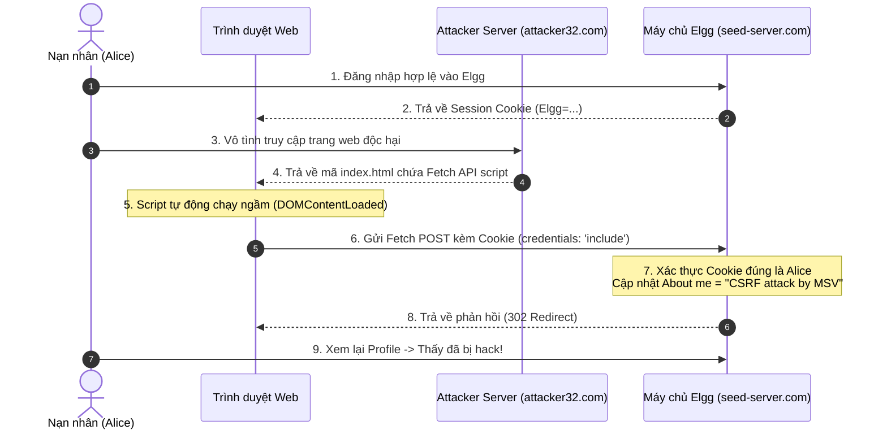

# ĐỀ CƯƠNG SLIDE THUYẾT TRÌNH (10 PHÚT) VÀ KỊCH BẢN THUYẾT MINH

> **Thời lượng báo cáo:** Chuẩn 10 phút  
> **Tổng số slide khuyến nghị:** 11 – 12 slide  
> **Công cụ hỗ trợ:** PowerPoint, Mermaid, Draw.io  

---

## ⏱️ PHÂN BỔ THỜI GIAN THUYẾT TRÌNH TỔNG QUAN

| Thứ tự Slide | Tiêu đề nội dung | Người trình bày (Speaker) | Thời gian ước tính |
| :---: | :--- | :---: | :---: |
| **Slide 1** | Trang bìa: Tên đề tài, Giảng viên, Thành viên nhóm | **TV2 (Browser & Defense Lead)** | 0:00 – 0:45 (45s) |
| **Slide 2** | Phân công công việc: Mô hình 2 tầng & Trách nhiệm | **TV2 (Browser & Defense Lead)** | 0:45 – 1:45 (60s) |
| **Slide 3** | Tổng quan CSRF, Bản chất Cookie & Bối cảnh Elgg | **TV2 (Browser & Defense Lead)** | 1:45 – 3:00 (75s) |
| **Slide 4** | Yêu cầu cải tiến: Chuyển dịch từ XHR/Form sang Fetch API | **TV1 (Technical & Offensive Lead)** | 3:00 – 4:00 (60s) |
| **Slide 5** | Phân tích gói tin HTTP POST Edit Profile (DevTools Network) | **TV1 (Technical & Offensive Lead)** | 4:00 – 5:00 (60s) |
| **Slide 6** | Kỹ thuật Fetch API: Xử lý Cookie (`credentials: include`) & CORS | **TV1 (Technical & Offensive Lead)** | 5:00 – 6:15 (75s) |
| **Slide 7** | Sơ đồ luồng dữ liệu tấn công tuần tự (Sequence Flow) | **TV3 (Server & Security Lead)** | 6:15 – 7:15 (60s) |
| **Slide 8** | Thực nghiệm tấn công & Ảnh chụp màn hình minh chứng | **TV3 (Server & Security Lead)** | 7:15 – 8:15 (60s) |
| **Slide 9** | Các giải pháp phòng thủ CSRF (SameSite, Token, Sec-Fetch) | **TV3 (Server & Security Lead)** | 8:15 – 9:00 (45s) |
| **Slide 10** | Báo cáo minh bạch mức độ ứng dụng AI (AI Disclosure) | **TV3 (Server & Security Lead)** | 9:00 – 9:35 (35s) |
| **Slide 11** | Kết luận, Đánh giá cá nhân & Hỏi đáp (Q&A) | **Cả 3 thành viên** | 9:35 – 10:00 (25s) |

---

## 🖥️ CHI TIẾT NỘI DUNG TỪNG SLIDE & KỊCH BẢN THUYẾT MINH (SCRIPT)

---

### 🔹 Slide 1: Trang bìa (Title Slide)
- **Tiêu đề lớn:** NGHIÊN CỨU VÀ THỰC NGHIỆM TẤN CÔNG CSRF TRÊN NỀN TẢNG ELGG BẰNG FETCH API HIỆN ĐẠI
- **Học phần:** An toàn và Bảo mật Hệ thống Thông tin (CS)
- **Giảng viên hướng dẫn:** *[Tên Giảng viên]*
- **Nhóm sinh viên thực hiện (3 thành viên):**
  1. *[Họ và tên TV1]* — MSV: *[MSV 1]*
  2. *[Họ và tên TV2]* — MSV: *[MSV 2]*
  3. *[Họ và tên TV3]* — MSV: *[MSV 3]*
- **Kịch bản nói (Presenter):**  
  > *"Kính chào thầy và các bạn. Hôm nay, nhóm chúng em xin phép trình bày báo cáo đề tài thực hành chuyên sâu: Tấn công Cross-Site Request Forgery (CSRF) trên ứng dụng mạng xã hội Elgg. Đặc biệt, nhóm chúng em đã cải tiến và hiện thực hóa cuộc tấn công bằng Fetch API và URLSearchParams theo chuẩn web hiện đại thay thế hoàn toàn các phương pháp truyền thống."*

---

### 🔹 Slide 2: Phân công công việc & Quy trình phối hợp
- **Bố cục:** Bảng ma trận RACI và 3 khối trách nhiệm chính:
  - **Thành viên 1 (Technical Lead):** Setup Docker Lab, bắt và phân tích gói tin F12, code `index.html` (Fetch API) và script `exploit.py`, thực nghiệm payload.
  - **Thành viên 2 (Media & Demo Lead):** Viết kịch bản video, quay màn hình Full HD, thuyết minh voiceover, biên tập video và đăng tải YouTube Unlisted.
  - **Thành viên 3 (Research & Slides Lead):** Thiết kế slide 10 phút, vẽ sơ đồ kiến trúc, giải toàn bộ 15 câu hỏi trong file `CSRF.docx`, tổng hợp tài liệu.
- **Kịch bản nói:**  
  > *"Để đảm bảo tính công bằng và hiệu quả cao nhất, nhóm 3 người chúng em đã chia đều khối lượng công việc thành 3 mảng độc lập nhưng phối hợp chặt chẽ: Bạn [Tên TV1] phụ trách kỹ thuật và lập trình mã khai thác; Bạn [Tên TV2] phụ trách truyền thông, kịch bản và sản xuất video demo; và Em/Bạn [Tên TV3] phụ trách thiết kế slide, vẽ sơ đồ và giải 15 câu hỏi học thuật trong tài liệu đính kèm."*

---

### 🔹 Slide 3: Tổng quan lỗ hổng CSRF & Bối cảnh Elgg
- **Nội dung hiển thị:**
  - Định nghĩa CSRF: Kẻ tấn công lừa trình duyệt của nạn nhân gửi các yêu cầu mạo danh đến máy chủ web mục tiêu mà nạn nhân đã đăng nhập từ trước.
  - Ba điều kiện cần của một cuộc tấn công CSRF:
    1. Nạn nhân có phiên đăng nhập còn hiệu lực (Active Session Cookie).
    2. Hành động mục tiêu gây thay đổi trạng thái (State-changing action) có thể dự đoán được tham số.
    3. Ứng dụng thiếu cơ chế phòng vệ (không có SameSite Strict/Lax hoặc Anti-CSRF Token).
  - Bối cảnh lab: Mạng xã hội Elgg chạy trên Apache container `www.seed-server.com`.
- **Kịch bản nói:**  
  > *"CSRF là lỗ hổng khai thác cơ chế tin cậy ngầm định của trình duyệt web: khi gửi request đến một domain, trình duyệt luôn tự động đính kèm cookie của domain đó. Trong bài lab này, ứng dụng Elgg lưu trữ thông tin người dùng, trong đó có trường About me. Mục tiêu của chúng em là khiến tài khoản của nạn nhân Alice tự động đổi About me thành chuỗi ký tự 'CSRF attack by <MSV>'."*

---

### 🔹 Slide 4: Yêu cầu cải tiến: Chuyển dịch từ XHR/Form sang Fetch API
- **Bảng so sánh 3 thế hệ tấn công:**
  - **HTML Form Submit:** Cũ, gây giật lag và chuyển hướng trang (page reload/redirect) $\rightarrow$ Dễ bị nạn nhân phát hiện. *(Đề bài cấm)*.
  - **XMLHttpRequest (XHR):** Mã nguồn cũ của SEED Labs, cú pháp rườm rà, chuẩn sắp lỗi thời. *(Đề bài cấm)*.
  - **Fetch API + URLSearchParams:** Chuẩn Web API hiện đại, xử lý bất đồng bộ qua Promise/Async-await, hoạt động ngầm tàng hình 100%, không chuyển trang. *(Đề bài bắt buộc)*.
- **Kịch bản nói:**  
  > *"Điểm đặc biệt và thách thức cốt lõi của đề tài này là giảng viên yêu cầu không được dùng mã mẫu XHR hay Form submit của SEED Lab cũ. Nhóm em đã chuyển dịch hoàn toàn sang Fetch API kết hợp với URLSearchParams. Đây là kỹ thuật khai thác hiện đại, chạy ngầm hoàn toàn và mang tính tàng hình cao độ."*

---

### 🔹 Slide 5: Phân tích HTTP POST Request qua DevTools Network
- **Hình ảnh chèn vào slide:** Ảnh chụp màn hình F12 Network tab khi Alice bấm "Save" trong Edit Profile.
- **Các thông số kỹ thuật được làm nổi bật (Callout/Box):**
  - **Endpoint:** `POST http://www.seed-server.com/action/profile/edit`
  - **Content-Type:** `application/x-www-form-urlencoded`
  - **Session Cookie:** `Cookie: Elgg=p0dci8baqrl4i...`
  - **Tham số cốt lõi:**
    - `guid = 42` (ID của nạn nhân Alice)
    - `name = Alice`
    - `description = <p>CSRF attack by B21DCCNxxx</p>`
    - `accesslevel[description] = 2` (Quyền xem Public)
- **Kịch bản nói:**  
  > *"Trước tiên, nhóm sử dụng DevTools Network tab để bắt gói tin khi Alice tự sửa profile. Ta thấy endpoint xử lý là `/action/profile/edit` qua method POST. Các trường dữ liệu gửi lên được định dạng theo chuẩn urlencoded. Trong đó, tham số `description` quy định nội dung About me và `accesslevel` bằng 2 để ai cũng nhìn thấy được nội dung bị sửa."*

---

### 🔹 Slide 6: Kỹ thuật Fetch API: Xử lý Cookie & Vấn đề CORS
- **Đoạn mã code khai thác then chốt:**
  ```javascript
  const payload = new URLSearchParams();
  payload.append('guid', '42');
  payload.append('name', 'Alice');
  payload.append('description', '<p>CSRF attack by B21DCCN001</p>');
  payload.append('accesslevel[description]', '2');

  fetch('http://www.seed-server.com/action/profile/edit', {
      method: 'POST',
      mode: 'no-cors',        // Bỏ qua kiểm tra Preflight CORS
      credentials: 'include', // BẮT BUỘC: Đính kèm Cookie phiên
      body: payload
  });
  ```
- **Hai điểm mấu chốt được giải thích:**
  1. `credentials: 'include'`: Mặc định Fetch cross-origin không gửi cookie; cờ này ép trình duyệt gửi cookie của Elgg.
  2. `mode: 'no-cors'`: Yêu cầu gửi Simple Request, không kích hoạt Preflight OPTIONS. Dù JavaScript không đọc được response, server Elgg vẫn thực thi lệnh sửa cơ sở dữ liệu!
- **Kịch bản nói:**  
  > *"Để Fetch API gửi được cookie qua cross-origin, chúng em bắt buộc phải cấu hình `credentials: 'include'`. Ngoài ra, vì form nhận dữ liệu urlencoded, đây là một Simple Request theo đặc tả W3C. Nhờ cờ `mode: 'no-cors'`, trình duyệt gửi thẳng request đến máy chủ Elgg mà không bị chặn bởi Preflight CORS. Phía server nhận được cookie hợp lệ và lập tức ghi đè dữ liệu!"*

---

### 🔹 Slide 7: Sơ đồ luồng tấn công (CSRF Attack Flow)
- **Sơ đồ đồ họa trực quan (Sequence Diagram):**



- **Kịch bản nói:**  
  > *"Trên slide là sơ đồ tuần tự toàn bộ kịch bản tấn công: Bước 1-2, Alice đăng nhập Elgg và trình duyệt giữ cookie phiên. Bước 3-4, Alice bị lừa nhấp vào trang web trúng thưởng của Attacker. Bước 5-6, đoạn mã JavaScript ngầm gọi Fetch API, gửi POST request kèm cookie của Alice tới Elgg. Bước 7, Elgg xử lý thành công. Cuối cùng, Alice vào lại trang cá nhân và thấy About me của mình đã bị thay đổi."*

---

### 🔹 Slide 8: Minh chứng thực nghiệm (Screenshots)
- **Bố cục chia 3 khung hình minh chứng:**
  1. **Ảnh 1 (Trước tấn công):** Trang Profile của Alice với trường About me ban đầu.
  2. **Ảnh 2 (Thời điểm tấn công):** Trang web của Attacker đang chạy, mở Console F12 hiển thị gói tin `fetch()` gửi thành công với status 200/302.
  3. **Ảnh 3 (Sau tấn công):** Trang Profile của Alice sau khi refresh, trường About me hiển thị rõ:  
     $$\text{“CSRF attack by B21DCCNxxx”}$$
- **Kịch bản nói:**  
  > *"Đây là các ảnh chụp thực nghiệm trực tiếp từ phòng lab: Bên trái là hồ sơ ban đầu của Alice. Ở giữa là trang web bẫy của Attacker đang kích hoạt Fetch ngầm trong Console. Và bên phải là kết quả sau khi Alice quay lại trang cá nhân: dòng chữ 'CSRF attack by <MSV>' đã xuất hiện chính thức trong trường About me!"*

---

### 🔹 Slide 9: Các giải pháp phòng thủ CSRF chuyên sâu
- **3 tầng phòng ngự chính:**
  1. **SameSite Cookie (Khuyến nghị hàng đầu):**
     - Đặt `SameSite=Lax` hoặc `Strict` cho Session Cookie. Trình duyệt sẽ từ chối gửi cookie trong các POST request từ bên thứ ba.
  2. **Anti-CSRF Secret Token (Synchronizer Token Pattern):**
     - Sinh token ngẫu nhiên gắn với session và nhúng vào form. Do chính sách Same-Origin Policy, kẻ tấn công không thể đọc trộm token này.
  3. **Kiểm tra Header bảo vệ (`Sec-Fetch-Site` & `Origin`):**
     - Máy chủ từ chối các request thay đổi trạng thái nếu `Sec-Fetch-Site: cross-site`.
- **Kịch bản nói:**  
  > *"Để phòng thủ toàn diện trước CSRF, giải pháp triệt để nhất là cấu hình cờ SameSite cho Cookie phiên thành Strict hoặc Lax. Đồng thời, các ứng dụng cần kích hoạt cơ chế Synchronizer Token: nhúng một token bí mật vào form mà kẻ tấn công cross-site không thể đọc được nhờ chính sách Same-Origin Policy."*

---

### 🔹 Slide 10: Tuyên bố mức độ ứng dụng AI (AI Disclosure)
- **Bảng phân loại minh bạch theo 3 mức độ của đề bài:**
  - **Mức độ 1 (Phản biện & Thảo luận giải pháp):** Sử dụng AI để thảo luận cơ chế hoạt động của `credentials: include` và tính chất Simple Request của `URLSearchParams` trong W3C CORS spec. Sinh viên tự viết code thực tế.
  - **Mức độ 2 (AI Đồng sáng tạo - Co-creator):** Sinh viên lên ý tưởng thiết kế kịch bản video, cấu trúc slide và nội dung câu hỏi; AI hỗ trợ định dạng văn bản, sinh sơ đồ tuần tự Mermaid.
  - **Mức độ 3 (AI Tạo sinh theo prompt):** Sử dụng AI tạo khung code ban đầu của `exploit.py` và template HTML cơ bản, sau đó sinh viên trực tiếp cấu hình thông số và kiểm thử.
- **Kịch bản nói:**  
  > *"Theo quy định của môn học, nhóm em xin công khai minh bạch mức độ sử dụng AI: Chúng em áp dụng AI ở Mức 1 để phản biện kỹ thuật CORS; Mức 2 để đồng sáng tạo định dạng sơ đồ và hoàn thiện câu từ; và Mức 3 cho bộ khung script ban đầu, mọi kết quả thực nghiệm và tính chính xác đều do nhóm trực tiếp chịu trách nhiệm."*

---

### 🔹 Slide 11: Kết luận & Hỏi đáp (Q&A)
- **Tổng kết:**
  - Hoàn thành 100% mục tiêu: Đổi About me thành `CSRF attack by <MSV>` bằng Fetch API không dùng XHR/Form.
  - Trả lời đầy đủ 15 câu hỏi trong file `CSRF.docx`.
  - Đóng gói đầy đủ mã nguồn, slide và video YouTube Unlisted.
- **Lời cảm ơn & Mời đặt câu hỏi:**
  - *"Cảm ơn thầy và các bạn đã chú ý lắng nghe! Nhóm chúng em rất mong nhận được những câu hỏi và đóng góp ý kiến."*
