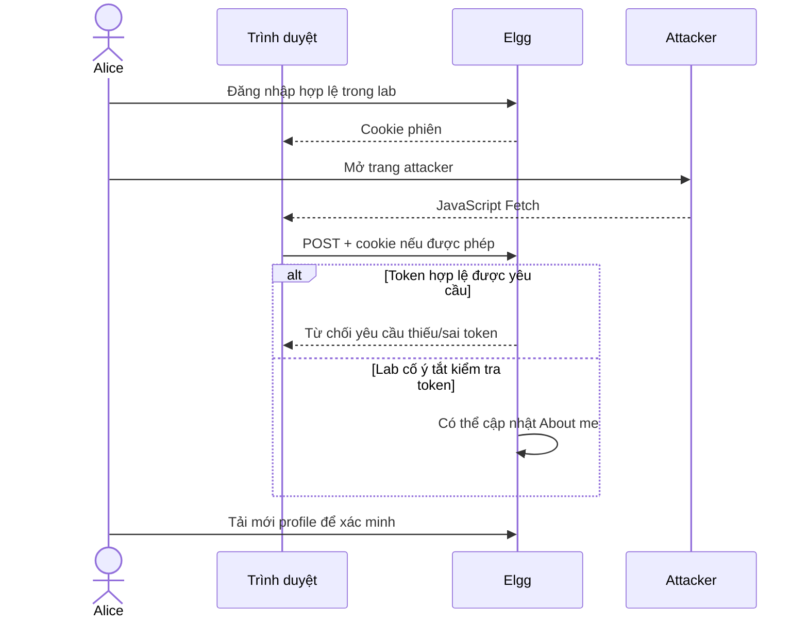

# CSRF: trình duyệt gửi phiên, máy chủ cần xác minh ý định

CSRF là việc một trang do attacker kiểm soát khiến trình duyệt người dùng gửi yêu cầu thay đổi trạng thái tới website mà người dùng đang có phiên. Ví dụ trong lab: Alice đã đăng nhập Elgg; JavaScript của một origin khác gửi POST chỉnh About me; nếu cookie được gửi và server bỏ kiểm tra token, server có thể nhận yêu cầu dưới phiên Alice.

Điều kiện gồm hành động thay đổi trạng thái; trình duyệt tự đính kèm một cơ chế xác thực như cookie; attacker biết cách tạo payload phù hợp; server chưa kiểm tra đủ nguồn gốc/ý định. Tài khoản tồn tại không đủ: phiên phải còn hiệu lực, cookie phải thỏa chính sách và server phải chấp nhận payload. [OWASP](https://cheatsheetseries.owasp.org/cheatsheets/Cross-Site_Request_Forgery_Prevention_Cheat_Sheet.html)

Session lưu trạng thái đăng nhập ở phía máy chủ hoặc cơ chế tương đương; cookie thường chỉ chứa định danh phiên. Cookie được trình duyệt quản lý theo host/domain/path, thời hạn và các thuộc tính bảo vệ. HttpOnly ngăn JavaScript đọc cookie, nhưng cookie vẫn có thể đi cùng Fetch nếu đủ điều kiện; vì vậy HttpOnly không tự chặn CSRF. Secure dùng cho HTTPS, không thay thế token. [Set-Cookie](https://developer.mozilla.org/en-US/docs/Web/HTTP/Reference/Headers/Set-Cookie)

Origin là bộ scheme, host, port. Hai cổng hoặc hostname khác nhau tạo origin khác nhau. Site xét scheme và registrable domain; port không làm thay đổi site. Do đó cross-origin có thể vẫn same-site. Hai hostname `elgg.csrf.localhost` và `attacker.csrf.localhost` dự kiến cùng site `csrf.localhost`; cần kiểm tra `Sec-Fetch-Site` trong trình duyệt. Cookie đặt host-only tránh gửi cookie Elgg tới hostname attacker; đổi cổng cùng hostname không đạt sự tách biệt cookie đó.

Same-Origin Policy giới hạn JavaScript truy cập tài nguyên origin khác. CORS là cơ chế server cho phép đọc response trong các tình huống liên quan. Simple POST với kiểu nội dung safelisted có thể được gửi trước khi browser kiểm tra quyền đọc response. Ngược lại request không đơn giản thường cần OPTIONS preflight được cho phép trước POST. Không thêm custom header chỉ để khiến demo thất bại. [Fetch](https://developer.mozilla.org/en-US/docs/Web/API/Fetch_API/Using_Fetch)

`credentials: 'include'` yêu cầu browser cân nhắc gửi credentials, không vô hiệu hóa SameSite, Secure, hạn dùng hay chính sách third-party cookie. `SameSite=Lax` thường không gửi cookie với cross-site Fetch POST; top-level navigation có quy tắc khác và không phải Fetch. `SameSite=Strict` vẫn cho cookie trong ngữ cảnh same-site, nên subdomain không đáng tin vẫn là mối nguy. `SameSite=None` cần Secure trong trình duyệt hiện đại; không thử trên HTTP bằng cách tắt bảo mật browser. [MDN cookie](https://developer.mozilla.org/en-US/docs/Web/HTTP/Reference/Headers/Set-Cookie)

CSRF token là giá trị server gắn với phiên/yêu cầu để kiểm tra thao tác xuất phát từ trang hợp lệ. Attacker origin khác không được mặc định đọc token nhờ SOP. Nếu tự lấy token Alice rồi dán vào attacker, thí nghiệm đã thêm năng lực vượt mô hình CSRF cơ bản. Trong lab này attacker từ chối token và timestamp xác thực.

| CSRF | XSS |
|---|---|
| Lợi dụng phiên tự gửi để tạo yêu cầu | Chạy script trong ngữ cảnh trang bị chèn mã |
| Không đòi đọc cookie/token nạn nhân | Có thể đọc DOM/token nếu chạy cùng origin |
| Token, kiểm tra origin, SameSite hỗ trợ phòng vệ | Encode output, sanitize, CSP và sửa điểm chèn mã |

Không suy luận token CSRF chống được XSS. Phòng vệ cần nhiều lớp: dùng CSRF middleware của framework, xác minh quyền với đối tượng đang sửa, Origin/Referer allowlist khi phù hợp, SameSite, Fetch Metadata và xác thực lại với hành động nhạy cảm. Bài thực hành tập trung token và cookie; các lớp khác là phân tích, chưa triển khai/thử trên Elgg trong bản này. [Elgg Actions](https://learn.elgg.org/en/stable/guides/actions.html), [OWASP](https://cheatsheetseries.owasp.org/cheatsheets/Cross-Site_Request_Forgery_Prevention_Cheat_Sheet.html)
