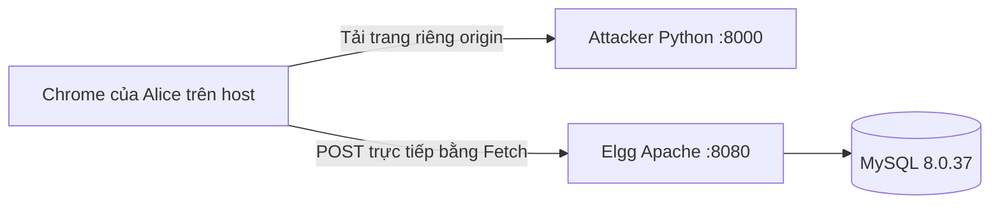

# Môi trường và khả năng tái hiện

Khảo sát: macOS 13.5 ARM64; Docker client 28.1.1 và Compose 2.36.0; Python 3.14.7; Node 24.18.0; Chrome, PowerPoint. Docker daemon có thể truy cập sau sandbox escalation. Không có Elgg cũ để dùng lại. Container của dự án khác không bị sửa hoặc dừng.



Compose có project name cố định `csrf-elgg-group6`; db volume chỉ của lab; network internal; port Elgg và attacker chỉ bind 127.0.0.1; DB không public. Không dùng host networking, privileged hoặc mount Docker socket. `exploit.py --bind 0.0.0.0` chỉ dùng bên trong container; chạy trên host mặc định 127.0.0.1.

Chạy `labctl init`, `fetch-seed`, `up`, `status`, `version` như README. `init` không ghi đè .env; tạo DB password ngẫu nhiên. `fetch-seed` kiểm tra SHA-256 ZIP và chỉ lấy SQL member cụ thể, bỏ site secret upstream. Boot tạo site secret bằng PHP random_bytes. SQL demo có tài khoản Alice, các mật khẩu giả lập công khai xem README.

Không chọn một phiên bản Elgg hiện hành rồi kết luận có lỗ hổng. Dùng image SEED original tương thích bài giảng; patch giữ kiểm tra token nguyên bản mặc định, chỉ return sớm cho `/action/profile/edit` khi đọc mode vulnerable. Path trong patch là thông tin từ gói SEED, **không phải capture Network của lần chạy này**. Nếu upstream đổi signature hoặc đã vô hiệu hóa kiểm tra, build dừng để kiểm tra thủ công. PHP profile reset/bootstrap và khả năng tương thích image chưa chạy trên Docker.

**Phiên bản chính xác trong image: chưa xác minh.** Tag `original-arm`/`original` chưa phải pin bất biến. Sau khi Docker chạy, `labctl version` đọc composer.lock và in image ID/digest; lưu vào evidence. Kiểm tra digest base riêng bằng `docker image inspect handsonsecurity/seed-elgg:original-arm --format '{{json .RepoDigests}}'`, rồi đặt `SEED_ELGG_IMAGE=repository@sha256:...` trong .env. Không bịa semantic version từ dữ liệu SQL năm 2020. MySQL pin tag 8.0.37; nếu cần lưu trữ dài hạn, ghi digest tất cả image. [SEED](https://seedsecuritylabs.org/Labs_20.04/Web/Web_CSRF_Elgg/)

Chrome thường hỗ trợ `.localhost`. Nếu không, thêm bằng quyền quản trị:

```text
127.0.0.1 elgg.csrf.localhost attacker.csrf.localhost
```

macOS/Linux: `/etc/hosts`; Windows: `C:\Windows\System32\drivers\etc\hosts`. Không sửa hosts toàn hệ thống tự động. Kiểm tra URL, scheme, port và Sec-Fetch-Site trên Network. Không bật cờ disable-web-security, không tắt SameSite để ép thành công.

Reset nhẹ: `labctl mode protected` rồi `labctl reset-profile` chỉ đổi About me Alice về baseline; cần kiểm chứng API tương thích sau khi image chạy. Dừng: `labctl down`, giữ DB. Full reset thủ công chỉ với lab: sao lưu cần thiết, `docker compose down`, xác định volume `csrf-elgg-group6_db_data`, xóa **chính volume đó** rồi chạy up; thao tác này xóa toàn bộ dữ liệu lab nên người chạy phải chủ động chọn. Không xóa volume dự án khác, không prune toàn máy.

Lỗi hiện tại: pull cả hai image báo input/output khi đĩa gần hết; kiểm tra image sau đó không phản hồi. Cần chỗ trống và Docker Desktop khỏe. Không chạy factory reset vì có dữ liệu/container dự án khác. Chỉ khởi động lại Docker Desktop khi người dùng đã sắp xếp việc gián đoạn các container khác.
