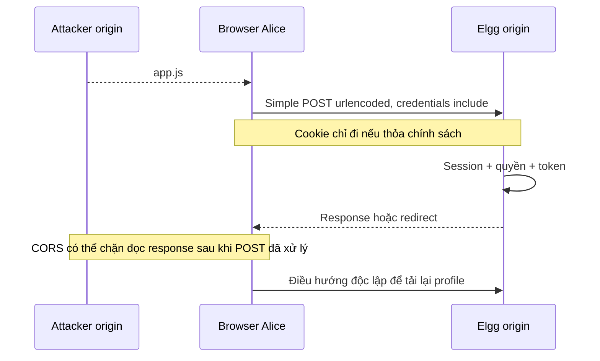

# Luồng Fetch và đối chứng

Đầu tiên chạy `/echo` cùng origin attacker. Nút TC-02 tạo URLSearchParams, POST đến server Python và xem decoded fields. Kết quả này chỉ chứng minh đóng gói đúng; không có session Elgg hoặc thay đổi profile. Ảnh thật TC-02 đã có trong evidence.

Sau khi capture Edit Profile, nhập URL đầy đủ và JSON các cặp field công khai. Không dán token, timestamp xác thực, password hoặc Cookie. Mã giữ field khác, thay đúng description bằng `CSRF attack by <MSV>`. URL bị giới hạn HTTP localhost/127.0.0.1/elgg.csrf.localhost. Không có auto-fire khi tải trang; người trình diễn chủ động bấm gửi và quan sát.

```js
const body = new URLSearchParams(publicFieldsFromNetwork);
body.set('description', `CSRF attack by ${studentId}`);
const response = await fetch(observedEndpoint, {
  method: 'POST',
  credentials: 'include',
  mode: 'cors',
  body
});
```

Đây là đoạn giải thích; implementation có kiểm tra đầu vào ở `attacker/request.mjs`. Không set Content-Type thủ công, không set Cookie và không thêm X-Requested-With. URLSearchParams tạo kiểu nội dung urlencoded thích hợp. Python chỉ phục vụ tài nguyên và echo, không chuyển tiếp POST tới Elgg.



| Origin attacker | Token check | Cookie dự kiến | Kết quả cần kiểm chứng |
|---|---|---|---|
| attacker.csrf.localhost | protected | Same-site có thể gửi | Không đổi, token bị từ chối |
| attacker.csrf.localhost | vulnerable | Same-site có thể gửi | Có thể đổi nếu request hợp lệ |
| 127.0.0.1 | vulnerable | Lax dự kiến không gửi cross-site Fetch | Không đổi, xác nhận lý do thiếu phiên |

Hai hostname cùng site mô phỏng một subdomain bị kiểm soát trong site, không phải hai registrable domain độc lập. Báo cáo phải nêu rõ giới hạn đó. Trường hợp cross-site thực có thể bị SameSite chặn; không đổi mô hình mà giấu người xem.

Đổi `mode: no-cors` cho response opaque, không cấp quyền đọc và không vượt SameSite/token. Dùng để so sánh quan sát, không để đánh dấu thành công. Thử `cors` và `no-cors` trên cùng fixture, reset About me trước mỗi lần.

Nguồn: [Fetch](https://developer.mozilla.org/en-US/docs/Web/API/Fetch_API/Using_Fetch), [Set-Cookie](https://developer.mozilla.org/en-US/docs/Web/HTTP/Reference/Headers/Set-Cookie).
